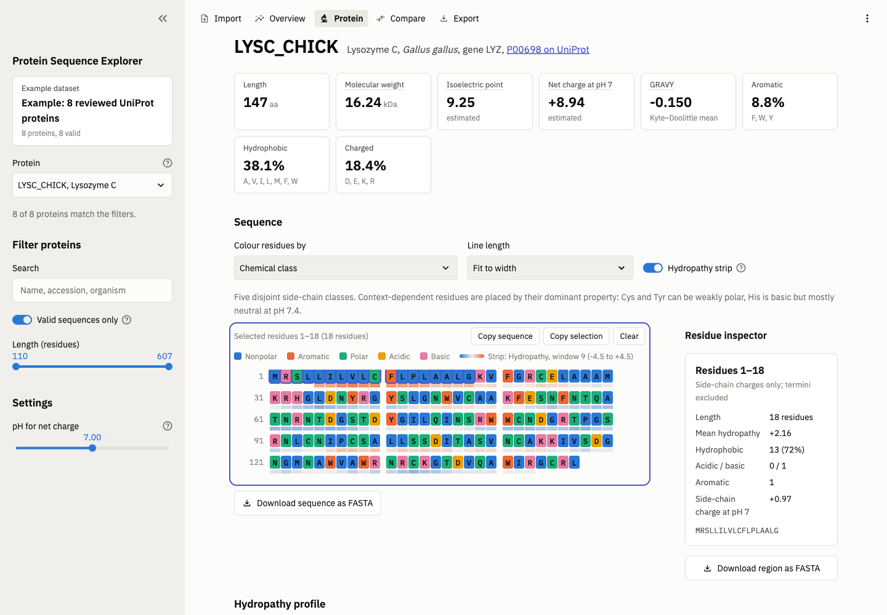
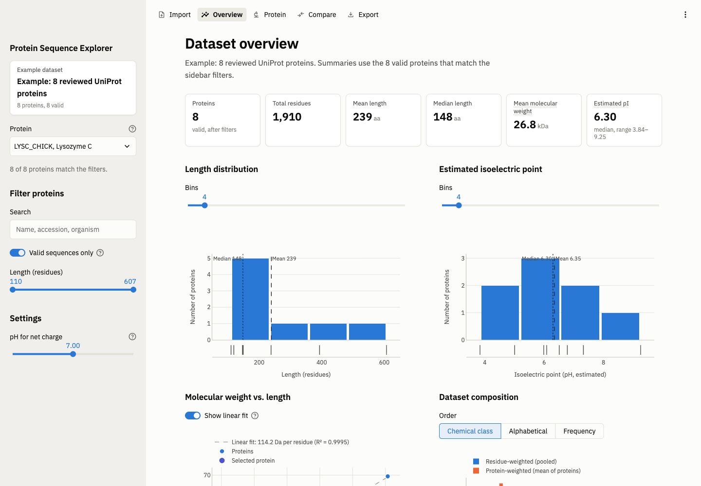
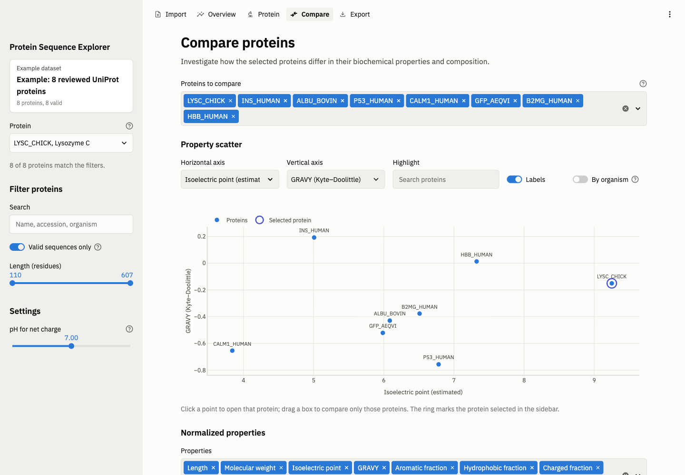
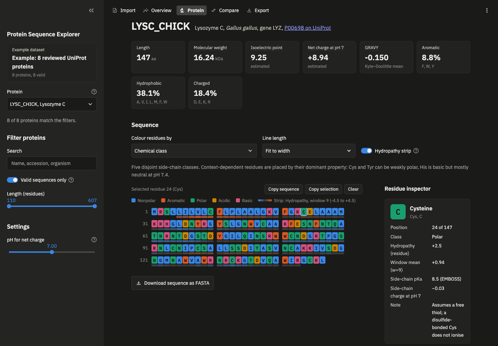
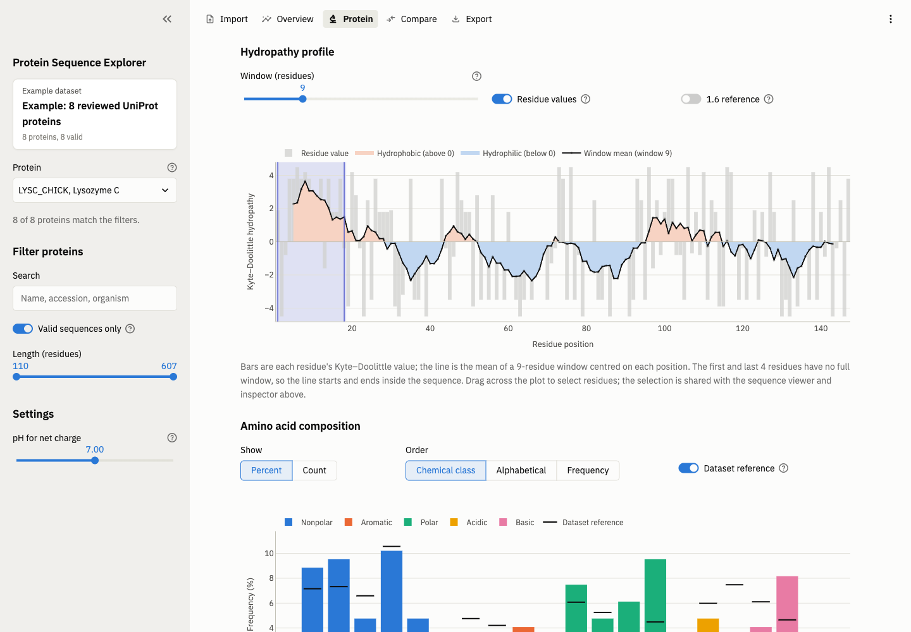

# Protein Sequence Explorer

A Python toolkit for reading protein FASTA files, validating sequences, and calculating biochemical features. The parser and features are written from scratch and checked against Biopython.

This is the first in a series of protein bioinformatics projects. The goal is a reliable foundation of hand-built sequence features to reuse later as inputs to machine learning models and as baselines against them, including protein language models (ESM), mutation-effect prediction, and protein design.



## Video Demo

https://github.com/user-attachments/assets/2b6b2c16-9c5d-4fd4-843b-0f98505b6adf


## Status

| Milestone | Status |
|---|---|
| 1. FASTA parsing and validation | Done |
| 2. Sequence features | Done |
| 3. DataFrames, CSV export, `analyze` CLI | Done |
| 4. Visualization | Done |
| 5. Biopython validation report | Done |
| 6. Interactive app (redesigned) | Done |
| 7. Documentation and demo | Done |

## Installation and launch

Requires Python 3.11+ and [uv](https://docs.astral.sh/uv/).

```bash
uv venv
uv pip install -e ".[dev,app]"   # app = Streamlit, Plotly, SciPy; dev = pytest, Biopython

# Interactive app (opens http://localhost:8501)
uv run streamlit run app/streamlit_app.py

# Run the tests
uv run pytest
```

### Command line

```bash
# Validate a FASTA file and print a summary table
uv run python -m protein_explorer summarize data/sample.fasta

# Compute all features and write CSV tables (net charge at pH 7.4)
uv run python -m protein_explorer analyze data/sample.fasta --output results/ --ph 7.4

# Static 300 dpi figures (png, svg, or pdf)
uv run python -m protein_explorer plot data/sample.fasta --output results/figures/ --window 9

# Compare against Biopython and write docs/validation_report.md
uv run python -m protein_explorer.crosscheck data/sample.fasta --output docs/validation_report.md
```

## The app

The app follows the workflow **Import → Overview → Protein → Compare → Export**. It opens on the bundled example dataset. The sidebar holds the protein picker, filters (search, validity, length), and the pH used for charge. Selections are shared: picking a protein anywhere updates every page, and a residue selection made in the sequence viewer or on the hydropathy plot appears in both, and in the inspector.

| Page | What it does |
|---|---|
| Import | Drag-and-drop FASTA upload, example loader, workspace reset, and a per-record validation table (valid, valid with warnings, failed). A malformed file is rejected with its line number and the previous dataset stays loaded. |
| Overview | Protein count, total residues, mean and median length, mean molecular weight, pI summary; length and pI distributions; molecular weight vs length with a least-squares fit; dataset composition, residue-weighted vs protein-weighted. |
| Protein | Metric cards, the interactive sequence viewer and residue inspector, the hydropathy profile, and composition (counts or percent, three sort orders, dataset reference). |
| Compare | Property scatter (any two of 8 properties; click a point to open that protein, drag a box to compare a subset), normalized property heatmap, composition heatmap with clustering, and a filterable comparison table. |
| Export | Feature, composition, count, summary, and dataset-composition CSVs; FASTA (all, valid, or filtered); a Markdown analysis report; run information JSON; a ZIP of 300 dpi figures. Every chart also saves a PNG from its toolbar. |

| Overview | Compare | Dark mode |
|---|---|---|
|  |  |  |

### Sequence viewer

- Residues in blocks of 10 with 1-based position numbers, wrapped to fit the width or at 30–100 per line
- Seven colouring modes: chemical class, amino acid identity, hydrophobic/hydrophilic, charge, polar/nonpolar, aromatic, and acidic/basic/neutral. Each mode uses the same residue sets as the matching feature, so colouring by "hydrophobic" highlights the residues counted by the hydrophobic fraction.
- Hover for name, one- and three-letter code, position, class, the residue's hydropathy, and the window mean at that position
- Click to select, shift-click for a range, arrow keys to move (shift extends), Escape to clear
- An optional hydropathy strip under each line, copy sequence or selection, and FASTA download of the protein or a selected region
- The inspector shows side-chain pKa and charge at the chosen pH for one residue, or segment statistics for a range

### Hydropathy profile

Per-residue Kyte–Doolittle values (bars) are drawn separately from the sliding-window mean (line), with the hydrophobic (> 0) and hydrophilic (< 0) regions shaded. The window is adjustable (5–21, odd). Window means exist only where a full window fits, so the first and last `window // 2` residues have none and the line is not extrapolated. Dragging across the plot selects those residues in the viewer, and the current selection is marked on the plot. The 1.6 transmembrane reference is off by default, because a peak above it is not evidence of a membrane helix on its own (see Findings).



### Comparison views

- **Normalized properties:** each property is z-scored across the proteins being compared, (value − mean) / SD, so properties in different units share one diverging scale. Colour is relative to the set, not absolute; hover shows the raw value.
- **Composition heatmap:** proteins × amino acids (percent), columns grouped by chemical class. Rows can be ordered by file, name, the frequency of any residue, or average-linkage hierarchical clustering on Euclidean distance between composition vectors.
- **Dataset composition:** residue-weighted pools every residue, so long proteins dominate. Protein-weighted averages each protein's own composition, so every protein counts equally.

## Data

`data/sample.fasta` contains 8 reviewed Swiss-Prot entries downloaded from [UniProtKB](https://www.uniprot.org) (CC BY 4.0): lysozyme C, insulin, bovine serum albumin, p53, calmodulin-1, GFP, β2-microglobulin, and hemoglobin β. Accessions and the download command are in [data/README.md](data/README.md).

These are full **precursor** sequences, including signal peptides and propeptides, not the mature proteins.

## Pipeline

1. **Parsing** (`fasta.py`). Reads records without modifying residues. Malformed files (sequence before a header, empty records, duplicate IDs) raise `FastaFormatError` with a line number.
2. **Validation** (`validation.py`). Flags invalid characters with their positions. Counts ambiguous (B/Z/J/X) and nonstandard (U/O) residues, accepts a terminal stop `*`, and rejects sequences that look like DNA or RNA (at least 20 residues long and at least 90% ACGTUN). Invalid sequences are reported rather than dropped.
3. **Features** (`features.py`) and residue reference data (`residues.py`), described below.
4. **Tables** (`dataset.py`). One row per protein with UniProt metadata (accession, protein name, organism, gene). Invalid sequences stay in the table with `NaN` features; a feature that can't be computed is `NaN` with the reason in `feature_errors`.
5. **Export** (`export.py`). CSV tables, `run_info.json` (input SHA-256, pH, pKa set, versions), FASTA that round-trips the input byte for byte, and a Markdown analysis report.
6. **Figures**. Static matplotlib figures (`plots.py`) and interactive Plotly figures (`visualization/`), sharing one colour-blind-safe palette with separate light and dark steps.

## Features

All features are **estimates calculated from sequence**, not measured values. Ambiguous and nonstandard residues count toward length. A terminal `*` does not.

| Feature | How it's calculated |
|---|---|
| Length | Number of residues |
| Residue counts and frequencies | Count / length for each of the 20 standard residues, always 20 keys in alphabetical order |
| Unique residue types | Number of standard residues present (0–20) |
| Hydrophobic fraction | (A+V+I+L+M+F+W) / length |
| Charged fraction | (D+E+K+R) / length. His is excluded because it is mostly neutral at pH 7.4 |
| Aromatic fraction | (F+W+Y) / length, the same definition as Biopython |
| Acidic and basic counts | D+E and K+R+H |
| GRAVY | Mean Kyte–Doolittle hydropathy over standard residues |
| Molecular weight | Sum of average residue masses + one water (Da). Assumes no PTMs and reduced Cys |
| Net charge at pH | Henderson–Hasselbalch over side chains and both termini, using EMBOSS pKa values |
| Isoelectric point | pH where net charge = 0, found by bisection on pH 0–14 |
| Hydropathy profile | Mean Kyte–Doolittle value in a sliding window (odd width, default 9) plotted at each window's centre residue |

## Validation against Biopython

[docs/validation_report.md](docs/validation_report.md) compares every overlapping feature with Biopython 1.88. Biopython is a dev dependency only, used for checking.

- **Molecular weight, aromaticity, GRAVY:** match to rounding error (≤ 0.00002 Da, exact for the others).
- **pI and net charge:** differ only because of pKa conventions. Given Biopython's pKa set and its terminal-residue adjustments, our code reproduces Biopython's pI with a remaining difference of 0.0000.
- **Tests:** `tests/test_vs_biopython.py` checks each feature for all 8 proteins, with tolerances justified in the file's docstring.

## Findings 

- **Molecular weight:**  69.3 kDa was calculated for BSA, against the usual 66.4 kDa. The gap is the 24-residue signal peptide and propeptide in the precursor sequence.
- **Disulfides:** BSA's 17 disulfide bonds make the true mass about 34 Da lower than we calculate, because it is assumed that every Cys is reduced. This is small compared with the precursor effect.
- **Isoelectric point:** The pI values differ from Biopython's by up to 0.58 units (HBB: 7.32 vs 6.74). Up to 0.51 units comes from using EMBOSS rather than Biopython's pKa values, and up to 0.07 from Biopython adjusting terminal pKa by residue. Both rank the 8 proteins in the same order.
- **GRAVY and solubility:** insulin has a positive GRAVY (+0.19 for the precursor, +0.22 for the mature A+B chains), yet it is a soluble hormone. GRAVY is a weak predictor of solubility.
- **Sequence length:** insulin is listed as 110 residues because UniProt stores preproinsulin. The active hormone is 51 residues.
- **Biopython pI clamping:** Biopython only searches pH 4.05–12, so for poly-Asp (D×20) it returns 4.05, where the net charge is −9.2. Our 0–14 search finds 2.76 with the same pKa values.
- **Residue handling vs Biopython:** Biopython's GRAVY raises an error on X, B, or U, and it counts a terminal `*` as a residue. We skip unknown residues in averages and strip `*`.
- **Transmembrane threshold:** none of the 8 sample proteins sits in a membrane, yet lysozyme and β2-microglobulin exceed the Kyte–Doolittle transmembrane cutoff (1.6 at window 19). In both, the peak falls in the signal peptide, so hydropathy alone can't tell a signal peptide from a transmembrane helix.

## Known limitations

- All values are estimates from the sequence as written. UniProt sequences are precursors, so signal peptides and propeptides are included, and post-translational modifications, disulfides, and structural pKa shifts are not modelled.
- pI and charge depend on the pKa set (EMBOSS here). Values from other tools can differ by about 0.5 pH units.
- Hydropathy cannot distinguish signal peptides from transmembrane helices, and residue classifications such as Cys, Tyr, and His are context-dependent.
- Hovering on the hydropathy chart does not highlight the sequence live, because Streamlit sends chart events only on selection. The hydropathy strip inside the viewer provides the same linkage on hover.
- Very long sequences (titin, 34,350 residues) render in under a second, but each selection takes about 2 s round trip. Per-residue hydropathy bars are turned off above 3,000 residues.


## Architecture

```
src/protein_explorer/
  fasta.py, validation.py, features.py   parsing, validation, feature calculations
  residues.py                            per-residue reference data (codes, names, pKa, hydropathy)
  dataset.py, export.py                  tables, metadata, CSV/FASTA/report export
  plots.py                               static matplotlib figures (CLI)
  crosscheck.py                          comparison with Biopython (dev only)
  visualization/                         Plotly figures and data models, no Streamlit
    theme.py            colour tokens (light/dark), chart styling, contrast helpers
    color_schemes.py    seven residue colouring schemes
    sequence_viewer.py  viewer data model: ResidueRange, tracks, annotations, positions
    hydropathy.py, composition.py, distributions.py, comparison.py, heatmaps.py, export.py
  ui/                                    Streamlit layer
    state.py            dataset, cached analysis, filters, shared selections
    sequence_viewer.py  custom component (assets/sequence_viewer.js, .css)
    residue_inspector.py, metric_cards.py, protein_selector.py, chart_controls.py, sidebar.py
    pages/              import, overview, protein, compare, export
app/streamlit_app.py, app/views/         entry point and thin page files
tests/                                   414 tests, including headless app tests
```

Scientific code never imports plotting or Streamlit. Visualization functions take data and a palette and return a figure. The sequence viewer is a reusable component with three extension points built in:
- `tracks`: per-residue values drawn under the sequence (hydropathy now; conservation scores or measurements later)
- `annotations`: labelled ranges such as domains or mutations
- `positions`: a column-to-residue mapping, so gapped alignment rows keep correct numbering


